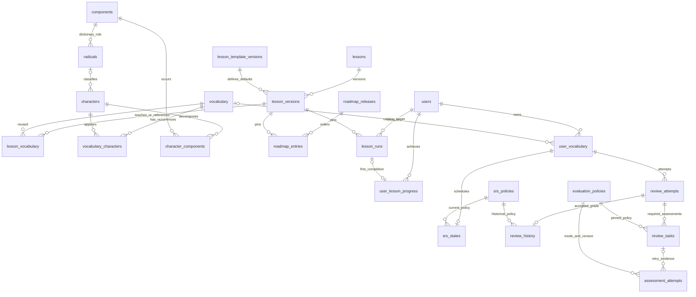
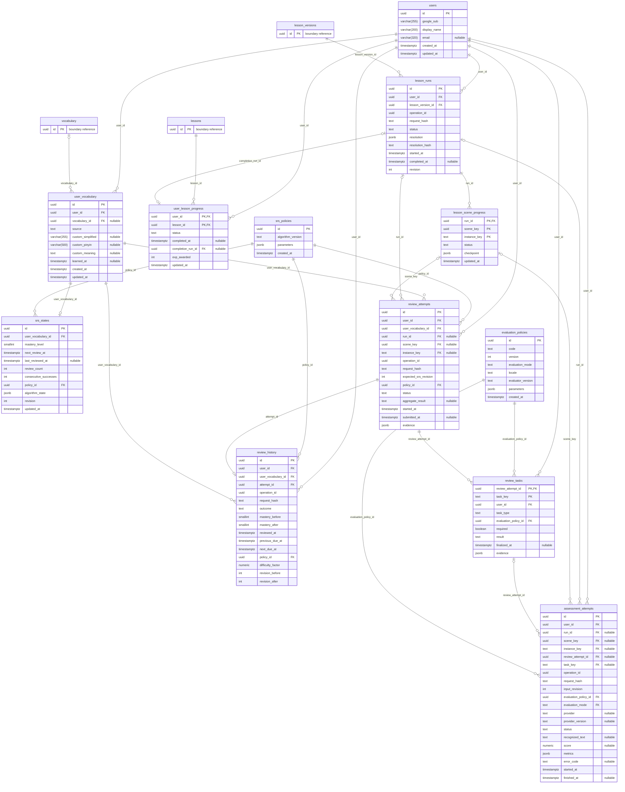

# Proposed database relationship diagrams

Status: **design only**, 2026-10-18. [Complete columns, constraints, indexes and ownership](database-design.md)
are authoritative. These diagrams cover all 45 proposed tables and every FK relationship.
Each detailed diagram includes all columns for its own group and ID-only boundary entities
for referenced tables defined in another group. A composite FK is one relationship edge,
labeled with its principal field; the full composite tuple is specified in the schema.
PK/FK annotations are informational; composite UQ constraints and conditional cardinality
are specified in the schema rather than hidden in diagram notation. Nullable FKs use an
optional parent. Identifying line style is not intended to encode every composite key.

## Overall view

This summary intentionally groups associations. The detailed diagrams below include them all.

## Learning Content

```mermaid
erDiagram
    characters o|--o{ components : character_id
    assets o|--o{ components : visual_asset_id
    components ||--o{ radicals : component_id
    radicals o|--o{ characters : radical_id
    assets o|--o{ characters : stroke_order_asset_id
    characters ||--o{ character_components : character_id
    components ||--o{ character_components : component_id
    assets o|--o{ vocabulary : audio_asset_id
    vocabulary ||--o{ vocabulary_characters : vocabulary_id
    characters ||--o{ vocabulary_characters : character_id
    vocabulary ||--o{ vocabulary_parts_of_speech : vocabulary_id
    parts_of_speech ||--o{ vocabulary_parts_of_speech : part_of_speech_id
    hsk_standards ||--o{ hsk_levels : standard_id
    vocabulary ||--o{ vocabulary_hsk : vocabulary_id
    hsk_levels ||--o{ vocabulary_hsk : level_id
    pronunciation_rules ||--o{ pronunciation_examples : rule_id
    vocabulary o|--o{ pronunciation_examples : vocabulary_id
    assets o|--o{ pronunciation_examples : audio_asset_id
    assets o|--o{ sentences : audio_asset_id
    sentences ||--o{ sentence_tokens : sentence_id
    vocabulary o|--o{ sentence_tokens : vocabulary_id
    sentences ||--o{ sentence_grammar : sentence_id
    grammar_rules ||--o{ sentence_grammar : grammar_rule_id
    grammar_rules ||--o{ grammar_examples : grammar_rule_id
    sentences ||--o{ grammar_examples : sentence_id
    assets {
        uuid id PK
        text storage_key
        text media_type
        text sha256
        bigint byte_length
        jsonb metadata
        timestamptz created_at
    }
    components {
        uuid id PK
        text glyph
        uuid character_id FK "nullable"
        text vietnamese_meaning "nullable"
        text explanation "nullable"
        uuid visual_asset_id FK "nullable"
        int revision
    }
    radicals {
        uuid id PK
        uuid component_id FK
        text dictionary_system
        int radical_number "nullable"
        text teaching_name "nullable"
        text notes "nullable"
        int revision
    }
    characters {
        uuid id PK
        varchar(8) hanzi
        uuid radical_id FK "nullable"
        int stroke_count "nullable"
        uuid stroke_order_asset_id FK "nullable"
        text classification "nullable"
        text classification_explanation "nullable"
        text classification_source "nullable"
        text structure_explanation "nullable"
        int revision
        timestamptz created_at
    }
    character_components {
        uuid character_id PK, FK
        int position PK
        uuid component_id FK
        text location
        text role
        text explanation "nullable"
    }
    vocabulary {
        uuid id PK
        varchar(255) simplified
        varchar(500) pinyin
        varchar(500) sino_vietnamese "nullable"
        varchar(1000) vietnamese_meaning
        text notes "nullable"
        uuid audio_asset_id FK "nullable"
        int revision
        timestamptz created_at
    }
    vocabulary_characters {
        uuid vocabulary_id PK, FK
        int position PK
        uuid character_id FK
    }
    parts_of_speech {
        uuid id PK
        text code
        text vietnamese_label
    }
    vocabulary_parts_of_speech {
        uuid vocabulary_id PK, FK
        uuid part_of_speech_id PK, FK
    }
    hsk_standards {
        uuid id PK
        text code
        text title
        text source_reference
    }
    hsk_levels {
        uuid id PK
        uuid standard_id FK
        text code
        int rank
        text label
    }
    vocabulary_hsk {
        uuid vocabulary_id PK, FK
        uuid level_id PK, FK
    }
    pronunciation_rules {
        uuid id PK
        text code
        text title
        text explanation
        int revision
    }
    pronunciation_examples {
        uuid id PK
        uuid rule_id FK
        uuid vocabulary_id FK "nullable"
        text chinese_text
        text citation_pinyin
        text spoken_pinyin
        text explanation
        uuid audio_asset_id FK "nullable"
        int revision
    }
    grammar_rules {
        uuid id PK
        text code
        text title
        text structure
        text explanation
        int revision
    }
    sentences {
        uuid id PK
        text vietnamese_prompt
        text chinese_text
        uuid audio_asset_id FK "nullable"
        jsonb accepted_variants
        text validation_version
        text status
        int revision
    }
    sentence_tokens {
        uuid sentence_id PK, FK
        int variant_index PK
        int position PK
        text surface
        uuid vocabulary_id FK "nullable"
        text nonlexical_kind "nullable"
    }
    sentence_grammar {
        uuid sentence_id PK, FK
        uuid grammar_rule_id PK, FK
    }
    grammar_examples {
        uuid grammar_rule_id PK, FK
        uuid sentence_id PK, FK
        int position
        text explanation "nullable"
    }
    learning_topics {
        uuid id PK
        text code
        text title
        text explanation "nullable"
        int revision
    }
```

## Learning Roadmap and Templates

```mermaid
erDiagram
    lessons ||--o{ lesson_versions : lesson_id
    lesson_template_versions ||--o{ lesson_versions : template_version_id
    assets o|--o{ lesson_versions : bundle_asset_id
    lesson_versions ||--o{ lesson_vocabulary : lesson_version_id
    vocabulary ||--o{ lesson_vocabulary : vocabulary_id
    lesson_versions ||--o{ lesson_grammar_rules : lesson_version_id
    grammar_rules ||--o{ lesson_grammar_rules : grammar_rule_id
    lesson_versions ||--o{ lesson_pronunciation_rules : lesson_version_id
    pronunciation_rules ||--o{ lesson_pronunciation_rules : pronunciation_rule_id
    lesson_versions ||--o{ lesson_topics : lesson_version_id
    learning_topics ||--o{ lesson_topics : topic_id
    lesson_templates ||--o{ lesson_template_versions : template_id
    lesson_template_versions ||--o{ lesson_template_scenes : template_version_id
    lesson_versions ||--o{ lesson_scenes : lesson_version_id
    lesson_versions ||--o{ lesson_prerequisites : lesson_version_id
    lessons o|--o{ lesson_prerequisites : required_lesson_id
    vocabulary o|--o{ lesson_prerequisites : required_vocabulary_id
    grammar_rules o|--o{ lesson_prerequisites : required_grammar_rule_id
    roadmap_releases ||--o{ roadmap_entries : release_id
    lessons ||--o{ roadmap_entries : lesson_id
    lesson_versions ||--o{ roadmap_entries : lesson_version_id
    lessons {
        uuid id PK
        text code
        text lesson_type
        text status
        timestamptz created_at
    }
    lesson_versions {
        uuid id PK
        uuid lesson_id FK
        int version
        text title
        uuid template_version_id FK
        text status
        int exp_reward
        uuid bundle_asset_id FK "nullable"
        timestamptz published_at "nullable"
        timestamptz created_at
    }
    lesson_vocabulary {
        uuid lesson_version_id PK, FK
        uuid vocabulary_id PK, FK
        int position
        text role
    }
    lesson_grammar_rules {
        uuid lesson_version_id PK, FK
        uuid grammar_rule_id PK, FK
        text role
    }
    lesson_pronunciation_rules {
        uuid lesson_version_id PK, FK
        uuid pronunciation_rule_id PK, FK
    }
    lesson_topics {
        uuid lesson_version_id PK, FK
        uuid topic_id PK, FK
    }
    lesson_templates {
        uuid id PK
        text code
        text description
    }
    lesson_template_versions {
        uuid id PK
        uuid template_id FK
        int version
        text status
        timestamptz published_at "nullable"
    }
    lesson_template_scenes {
        uuid template_version_id PK, FK
        uuid scene_key PK
        int position
        text scene_type
        int contract_version
        boolean required
        jsonb config
        jsonb condition "nullable"
    }
    lesson_scenes {
        uuid lesson_version_id PK, FK
        uuid scene_key PK
        text operation
        int position "nullable"
        text scene_type "nullable"
        int contract_version "nullable"
        boolean required "nullable"
        jsonb config "nullable"
        jsonb condition "nullable"
    }
    lesson_prerequisites {
        uuid id PK
        uuid lesson_version_id FK
        text scope
        uuid scene_key "nullable"
        uuid required_lesson_id FK "nullable"
        uuid required_vocabulary_id FK "nullable"
        uuid required_grammar_rule_id FK "nullable"
    }
    roadmap_releases {
        uuid id PK
        int version
        text status
        int review_every_n_vocabulary
        timestamptz published_at "nullable"
        timestamptz created_at
    }
    roadmap_entries {
        uuid release_id PK, FK
        uuid lesson_id PK, FK
        uuid lesson_version_id FK
        int position
    }
    assets {
        uuid id PK "boundary reference"
    }
    grammar_rules {
        uuid id PK "boundary reference"
    }
    learning_topics {
        uuid id PK "boundary reference"
    }
    pronunciation_rules {
        uuid id PK "boundary reference"
    }
    vocabulary {
        uuid id PK "boundary reference"
    }
```

## User Progress, Evaluation and SRS

## Relationships enforced outside ordinary FK edges

- Scene keys and assessment contexts must match their pinned manifest, user, target and policy.
- Completion-run lesson identity matches the accomplishment; composite FKs enforce ownership.
- Prerequisite publication rejects cycles and unresolved knowledge producers under the curriculum lock.
- App-learned vocabulary/grammar derives only from completed TEACHES relations.
- Public bundles pin content; catalog edits do not rewrite an open run.
- Each review pins a nonempty required task set; all tasks must finalize valid PASS/FAIL before grading.
- Aggregate PASS means every required task passed; a technical blocker leaves the aggregate ungraded.
- Assessment retries reference the same parent review/task and never independently change mastery.
- History/state/aggregate outcome change atomically under the scheduling revision.
- Evaluation policy and constrained attempt mode preserve STT vs detailed-assessment semantics.

No FK equates lesson completion with mastery. SRS state and history both reference the
personal entry; accepted history is not a child of replaceable current state. Raw recordings
are ephemeral processing inputs and have no public assets relationship.
