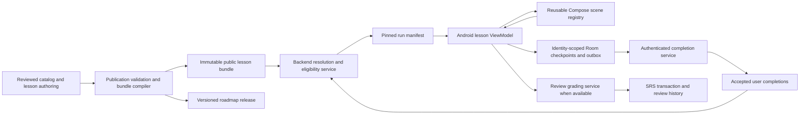

# Data-driven Learning Engine proposal

Status: **runtime design; Slice 1 authoring subset implemented**, 2026-10-18.
The local preview compiler and two reference scene contracts are described in
[content authoring](content-authoring.md). The remaining contracts, endpoints, renderers,
sync protocol and evaluators below remain future design. Slice 1 has no lesson overrides,
runtime conditions or evaluation policy tables. Its published previews cannot complete learning.
See [schema](database-design.md), [examples](lesson-examples.md), [SRS](srs-design.md),
[implementation slices](mvp-implementation-plan.md), and [ERDs](database-erd.md). Existing architecture/authentication/offline documents
continue to describe the scaffold; these documents describe its proposed evolution.

## 1. One execution engine

The lesson type identifies educational intent: VOCABULARY, PRONUNCIATION, GRAMMAR,
TOPIC, or REVIEW. It does not choose a separate execution implementation. A lesson
definition supplies a sequence of typed scenes, requirements and completion rules.
VOCABULARY has one TEACHES lexical target; other types can mix references to words,
rules and examples. REVIEW is a roadmap activity; it is not automatically an SRS grade.



FastAPI routing/Pydantic contracts remain in api/schemas. Concrete services own
publication, eligibility, completion and grading transactions; query repositories return
data without committing. Do not create a generic engine service hierarchy or speculative
use cases. Android repositories map bundle/wire/cache types into domain definitions;
a lesson ViewModel exposes immutable StateFlow. Composables only render state and emit
events. Audio capture, Canvas input, STT evaluation and future specialized assessment sit behind
injected interfaces, outside renderers. STT returns a content-match result, not a
detailed pronunciation assessment. Preserve coroutine cancellation and lifecycle collection.
There is still one Android Gradle module and no new framework in this proposal.

## 2. Authoring, versions and publication

1. An editor creates a stable lesson and a DRAFT lesson_versions row referencing one
   exact lesson_template_versions row. Only published template versions can be published
   as lesson dependencies. A template defines ordered stable scene_key UUIDs, scene
   types, contract versions, required flags, configs and optional condition objects.
2. lesson_scenes stores sparse ADD/REPLACE/REMOVE operations. ADD introduces a fresh
   scene_key; REPLACE preserves an inherited key but supplies a complete definition;
   REMOVE suppresses an inherited definition. Do not recursively merge JSON. Unchanged
   scenes inherit. Assign distinct nonnegative positions after all operations; gaps are
   fine. Scene removal/order conflicts fail publication rather than being guessed.
3. Typed bindings such as `{"binding":"TARGET_VOCABULARY"}` resolve to the one
   TEACHES entry. Bindings are a finite server whitelist, not SQL/property paths or scripts.
   Override configs use either a valid binding or concrete ID, never both.
4. The publisher validates reference existence/type, lesson cardinality, assets/licenses,
   rule/sentence annotations, prerequisites, scene config versions, completion feasibility,
   unique positions/keys, and minimum supported client capabilities. It traverses required
   prerequisite graphs under the curriculum publication lock described in the schema.
5. Compile the resolved scene definitions and referenced catalog display projections
   into a content-addressed immutable bundle. Save its public assets FK, then publish
   the lesson version atomically. Failed publication leaves a draft; abandoned uploaded
   objects can be garbage-collected only after a reference/retention check. This compiler
   is a proposed authoring responsibility, not a runtime dependency on arbitrary code.
6. Publish a roadmap release with exact lesson versions. Position changes do not alter
   lesson IDs or accomplishments. New content adds nodes; completed lessons stay completed.

Template publication never rewrites existing lesson versions. A content change creates
a new lesson version, possibly pointing at a new template version. Existing runs pin
the old bundle/version/resolution. The same conceptual scene keeps its scene_key across
compatible versions; a different exercise purpose gets a new key. Clients dispatch on
`(scene_type, contract_version)`. Unknown required scene versions block starting the
lesson with a Vietnamese update message; unknown optional types are skipped only if
the server already declares that safe and records the skip in the manifest. An application
upgrade must not turn unsupported required scenes into completed scenes.

Published catalog changes require a new bundle to reach learners. Word/sense identities
and published sentence annotations cannot be repurposed in place. Full vocabulary records
are not stored in scene config JSONB. Historical bundle assets are retained for resumable
runs; archive prevents new starts but does not invalidate accepted accomplishments.
Security-driven withdrawal may suspend a run, with explicit migration/restart UX and no
silent EXP loss. The duration of old-client support is a product decision.

## 3. Scene registry and contracts

All scene configs use a discriminated versioned schema, validated by the publisher and
again at the API/client boundary. Every scene envelope has scene_key UUID, scene_type,
contract_version, required boolean, config object, optional condition, and ordered position.
The runtime adds instance_key and a resolved inclusion/skip decision. Noninteractive
acknowledgment and validated submission are distinct completion events. Configs contain
references and small policy values, never large media or duplicated dictionary entries.

| Scene type (contract v1) | Expected config inputs | Validation and completion responsibility |
| --- | --- | --- |
| VOCABULARY_INTRODUCTION | vocabulary_ref; show_pinyin; listen_required; recording_policy; speech_evaluation_policy_id | Resolve lexical text/audio from bundle. The default speaking introduction requires microphone permission, valid capture and STT content PASS (or recorded approved alternative); no invented pronunciation score. |
| VOCABULARY_INFORMATION | vocabulary_ref; fields enum array | Allowed fields POS, SINO_VIETNAMESE, MEANING, NOTES, CHARACTER_CLASSIFICATION. Character classifications are per character, never whole-word etymology. Acknowledge viewed pages. |
| CHARACTER_ANALYSIS | vocabulary_ref; expansion PER_COMPONENT; include_unreviewed boolean | Expand ordered character occurrences, then ordered reviewed component occurrences. Separate dictionary radical display. Missing analysis gives explicit informational fallback; it never invents components. |
| STROKE_ANIMATION | vocabulary_ref; character_positions int array or ALL; replay_allowed | Require supported stroke assets for selected character occurrences, or an explicitly reviewed equivalent static demonstration. Completion is viewing/acknowledgment, not handwriting correctness. |
| HANDWRITING_PRACTICE | vocabulary_ref or character_ids; mode FREEHAND_RECALL; retries; completion_policy | Exactly one target source. Ordered strokes, no snapping. Require nonempty user capture and confirmation per target or accessibility equivalent. No correctness claim before evaluator exists. |
| PRONUNCIATION_PRACTICE | pronunciation_example_id or vocabulary_ref; replay_policy; recording_policy; speech_evaluation_policy_id | Exactly one target; microphone and valid recording required. STT_CONTENT_MATCH gives content PASS/FAIL only. Future PRONUNCIATION_ASSESSMENT uses its own policy and score threshold. Technical blockers remain recoverable. |
| CONTENT_EXPLANATION | grammar_rule_id, pronunciation_rule_id, topic_id, or bounded reviewed text; example_ids | Exactly one primary source, references checked against appropriate entities; safe plain text/allowlisted formatting, no executable markup. Complete on acknowledgment. |
| AUDIO_COMPARISON | reference_asset_ids; labels; replay_policy; comparison_prompt | At least two reviewed audio references aligned with labels. Prompt must not imply an unlabeled incorrect audio sample is correct pronunciation. Complete acknowledgment or a separately configured supported question. |
| MULTIPLE_CHOICE | prompt; options with stable keys; correct_option_keys; shuffle; attempts; hint_policy | At least two unique options, nonempty valid answer subset. Validate submission keys and retry policy deterministically. Answers may be visible offline; do not claim tamper-proof assessment. |
| FILL_IN_BLANK | sentence_id; blank_spans; accepted_fills; attempts; hint_policy | Spans match pinned text and do not overlap; fills are reviewed. Annotate complete sentence vocabulary/grammar before applying restricted practice policy. |
| SENTENCE_ORDERING | sentence_id; token_keys; accepted_orders; attempts | Preserve repeated tokens with unique occurrence keys; accepted orders are permutations and form reviewed variants. |
| SENTENCE_TRANSLATION | sentence_pool_ids; selection_count; answer_modes; recording_policy; evaluation_policy; speech_evaluation_policy_id | Backend enforces vocabulary/grammar eligibility. Final selected text is graded deterministically; the speaking step requires valid capture and STT content PASS under a distinct speech policy. Future detailed pronunciation metrics are not implied. |
| LISTENING_TRANSCRIPTION | target_ref; audio_asset_id; accepted_texts; pinyin_visibility; replay_policy; hint_policy; answer_mode; scoring_policy; max_attempts | target_ref is one of character/vocabulary/sentence/reviewed phrase. Audio/expected text aligned. Validate variants, explicit normalization, bounded replay/attempts. Compare final selected text, never recognition confidence. |

Reusable entities are words, characters, components/radicals, media, sentences, pronunciation
rules/examples, grammar rules/examples and topics. Prompt labels, option arrays, ordering,
display flags, small accepted strings and input/scoring policies belong in validated JSONB.
Sentence answers with lexical/grammar eligibility use the annotated sentence bank, not
an untracked free-text translation in config. Scene-specific config schemas may share
small typed policy schemas; there is no table for each renderer. Required/evaluation
fields must be supported in the advertised renderer capability set.

Suggested bounded v1 policies: replay `{ "max_replays": 3 }` or null for unlimited;
hint `{ "enabled": false }`; attempts positive integer; pinyin NEVER/AFTER_SUBMIT/ALWAYS;
answer modes KEYBOARD/FREEHAND_SELECTED_TEXT. Speaking uses REQUIRED_CAPTURE; a non-speaking
variant must be explicitly authored as such or selected through an approved accessible
alternative, never created automatically after a permission/service failure. Exact defaults
must be published in each config contract, never depend on client build defaults.

## 4. Expanding definitions into a pinned run

The start service authenticates the account, checks current lesson availability/unlock,
client capabilities and bundle hash, then creates/reuses a run using a user-scoped
operation UUID and request hash. Reusing an operation with another payload is a conflict.
The service resolves template bindings and creates an ordered manifest of scene instances.
For character analysis, instance_key is derived from source character position plus
component position, e.g. `char:1/component:0`; handwriting uses `char:0`. Definition
scene_key remains stable. Repeated characters in 爸爸 still have separate occurrences.

The run's resolution stores manifest instance IDs, references, condition policy version,
eligibility evidence/candidate sentence IDs, skip reasons, required flags, and hash of
the public bundle. It is not a second copy of vocabulary/media. Every progress operation
must target a manifest instance and expected run revision. Replays can create another run
after the active one ends; different runs cannot combine arbitrary successful scene results.

For required deterministically scored exercises, the proposed default is an accepted
correct submission within max_attempts. Exhausting attempts leaves that run incomplete;
offer feedback and a fresh run rather than silently passing the scene. Optional exercise
failure does not block lesson completion. Study-only acknowledgment/capture scenes use
their explicitly defined completion events instead of a correctness gate. Remediation
UX and accessibility alternatives need product approval before these defaults ship.

Completion requirements for initial vocabulary learning: intro/listening and speaking,
information, reviewed component explanation, stroke demonstration and freehand capture/
confirmation are required. Speaking requires microphone permission, valid recording and
STT_CONTENT_MATCH PASS under the pinned policy. Handwriting remains a study capture unless
an appropriate assessment is explicitly supported. Technical problems preserve the same
run/checkpoint; do not fail it, award completion or force loss of completed scenes. A
published accessible alternative may fulfill a learning requirement with its own recorded
completion method; it never masquerades as a successful speech measurement.

Generic lesson exercise retry exhaustion can offer a fresh practice/run without EXP
changes. A due SRS review instead retains one parent review identity and pinned task set;
scene/input retries do not start independent graded reviews. See srs-design.md for task
finalization and all-required-task aggregate rules.

## 5. Conditional inclusion and eligible sentences

The proposed default minimum_sentence_count is **1**, configurable per lesson; publication
requires selection_count <= minimum_sentence_count (or a stricter explicit availability
condition). There is no vocabulary-count-only shortcut.

Conditions are typed whitelist objects, not executable expressions. Initial whitelist:
ELIGIBLE_SENTENCE_AVAILABLE, HAS_APP_VOCABULARY, HAS_GRAMMAR_RULE, ALL, ANY. Composite
ALL/ANY have nonempty child arrays and maximum depth/child bounds (proposed depth 3,
20 total nodes). Unknown types/versions fail publication. References in condition JSON
are checked against catalog IDs at publication; foreign keys in lesson_prerequisites
remain the preferred normalized representation for named prerequisite requirements.

```json
{
  "type": "ELIGIBLE_SENTENCE_AVAILABLE",
  "schema_version": 1,
  "vocabulary_source": "COMPLETED_APP_LESSONS",
  "minimum_sentence_count": 1,
  "allow_current_target_after_core": true
}
```

Backend algorithm proposal:

1. Compute V from accepted first completions and their exact TEACHES vocabulary rows;
   compute G from accepted TEACHES grammar rows. Ignore user-entered known-word claims,
   custom library entries, externally learned words, CONTEXT/REVIEWS associations and
   merely saved entries. Do not split learned 你好 into automatically learned 你 and 好.
2. For a current VOCABULARY target t, optionally form V' = V union {t} only for the
   conditional scene after the configured required core instances are accepted in this
   run. This is a run-local capability, not an early durable learned-word grant. The
   eligible sentence set can be precomputed provisionally using V' at start; it remains
   locked until the core gate is verified. Templates cannot let the target or a condition
   depend on the conditional exercise itself. Current grammar is not granted early in v1.
3. For each published candidate sentence, take the union of lexical IDs across canonical
   text and **all accepted variants**; require subset of V', and require its annotated
   grammar subset of G. Check lesson-specific SCENE prerequisites and configured sentence
   pool. Include lexical particles, numerals, classifier forms and names; only punctuation
   and whitespace are nonlexical. Full annotation coverage is mandatory. Empty grammar
   annotations require explicit reviewed justification, not a default bypass.
4. Require at least minimum_sentence_count distinct eligible sentences, independent of
   vocabulary size. Pin a deterministic selection and validation_version; record the
   evidence and condition result. If none/too few, mark SKIPPED_INELIGIBLE, which satisfies
   this conditional gate for this run. A required conditional scene means required **if
   included**; it never prevents completion when its published skip policy applies.
5. Future generated sentences enter DRAFT only. A deterministic validator checks token
   coverage, lexical identity/sense, accepted variants, allowed grammar patterns and target
   requirements; ambiguous segmentation or unsupported grammar fails closed for editorial
   review. An LLM's own declarations or prompt are not evidence of compliance. MVP uses
   curated sentences, avoiding a speculative universal Chinese grammar parser.

Grammar onboarding cannot depend exclusively on translation that itself needs unknown
grammar. Introductory grammar lessons use explanation/reviewed examples and deterministic
forms; their completion can grant TEACHES grammar evidence. Examples may introduce new
content for teaching; restricted translation uses only eligible vocabulary and grammar.
These are explicit pedagogical modes, not accidental eligibility bypasses.

The run freezes decisions. If another device completes a prerequisite later, a previously
skipped scene stays skipped for this run and accomplishment. A fresh practice/replay run
can include it with new evidence; no retroactive lesson incompletion or extra EXP. The
UI can offer the newly available practice without silently inserting it into an open run.

## 6. Atomic lesson completion and EXP

Proposed service transaction:

1. Lock the authenticated run; ensure revision, exact pinned bundle and status. Validate
   required instances/core gates against server-understood events; accept conditional skips
   only from the manifest. An optimistic client finished flag is insufficient.
2. Ensure user_lesson_progress exists, lock it in a consistent order (run then accomplishment),
   and validate same owner/lesson. A second concurrent run serializes at this unique row.
3. If first valid completion, set status/completed_at/completion_run_id and exp_awarded
   from the pinned version. Insert/upsert catalog library targets; set learned_at if NULL
   for TEACHES entries, preserving custom entries and prior schedules. Completion itself
   provides durable learning provenance. Create initial SRS state only if the separately
   approved enrollment policy calls for it, with mastery 0, never a lesson-earned level.
4. Mark run complete and commit all effects together. A retry returns the recorded result;
   a later replay can complete its run but changes neither first completion nor EXP. A
   different reward in a later version does not top up old EXP automatically. Total EXP
   comes from committed accomplishments, so rollback cannot leave an awarded total behind.

Unique keys and row locks enforce one first completion. Client operation UUIDs are reused
on retries; start request hashes reject mismatched reuse. Completion semantics are monotonic
and tied to a stable run: repeating completion of that run reads its stored outcome. Full
offline operations beyond these semantics need transactional receipts as described in
offline-sync.md before launch. No unauthenticated progress routes are proposed.

## 7. Offline scope and reconciliation

Offline-first is a target, not a claim about the health demo. A useful first delivery can
download public bundles and start authenticated resolved runs online, then allow local
execution/checkpoints offline. A manifest pins bundle/version, eligibility snapshot,
condition policy, expected account and server revision. Cache all selected scene assets
before declaring the bundle offline-ready. Missing required media blocks start/resume
with retry; it does not complete the scene automatically.

Room stores local stroke streams and ordered progress; committing a local change and an
identity-scoped outbox event must be atomic. Local completions/EXP are explicitly provisional
until server acceptance. Local current-target capability may unlock its pinned conditional
scene after local core work, but sync rechecks those core events. Offline completions of
other lessons cannot silently extend a server-pinned eligible set; reconcile prerequisites
first or start another resolved run online. If eligibility cannot be proven from a previously
accepted snapshot, skip optional restricted scenes or defer their resolution, rather than
using a guessed vocabulary count. Do not convert server-required exercises to optional.

New offline run creation, cross-device merge, signed/leased eligibility snapshots and
incremental catalog pulls require a later concrete sync contract. Before enabling offline
completion uploads, design durable operation receipts, payload hashes, server cursors,
lease expiry and receipt retention. An account change cancels work and isolates pending
events; device timestamps are advisory, never last-write-wins authority. The server
reconciles content identity, revision and previous completion before awarding anything.
Stale SRS events follow the conservative practice-only policy in srs-design.md.

## 8. Handwriting, transcription and future evaluation

Use a bounded stroke document with format_version, target occurrence, coordinate-space
size/orientation, and an ordered list of strokes containing x/y/time points, optional
pressure, and monotonic timing. Preserve natural strokes, pen lifts and point order;
no automatic snapping. Undo/removal and retry create a revised local attempt without
overwriting previously submitted evidence. Limits on points/duration protect memory;
sampling must preserve enough geometry and document any simplification.

Separate representations: raw strokes -> recognition candidate list with provider/version
and optional confidence -> user's chosen Hanzi per slot -> final text submission. Correcting
a selected character changes the text revision. Recognition confidence describes a proposed
reading of strokes, not whether that text answers the exercise or follows stroke order.
With recognition absent, freehand can pair with a manual character picker/keyboard; no
fabricated candidates or correctness scores. Store raw strokes locally initially.

LISTENING_TRANSCRIPTION can target a character, word, reviewed phrase or sentence in any
lesson type. Expected/accepted text and normalization policy are explicit. Proposed text
policy NFC_TRIM_OUTER removes surrounding whitespace only, preserving internal spaces,
punctuation and Hanzi distinctions. Additional accepted punctuation/text variants must
be reviewed, not inferred by aggressive normalization. Replay/hint/attempt counters belong
to scene/attempt evidence; retry policy is enforced by the coordinator. A deterministic
text score may grade final selected text; handwriting shape remains ungraded without
a supported evaluator. Speech is evaluated for recognized content only under the separate
STT contract below, with no tone/phoneme correctness claim. Future asynchronous evaluator results must bind to the
submitted attempt revision, never update the wrong retry or run after cancellation.


## 9. Required speaking and provider-independent evaluation

The conceptual interface (contract only, not implementation) is
`PronunciationEvaluator.evaluate(EvaluationRequest) -> EvaluationResult` and a capability
query for supported modes/locales/metrics. The backend owns the adapter/comparison service;
Android invokes an application repository contract and never embeds provider credentials.
Renderers submit events to the ViewModel/coordinator, not SDK calls. Adapters can change
without changing scene execution; evaluator/policy versions pin the semantics.

EvaluationRequest contains assessment_attempt_id, input revision, authenticated target
context, immutable evaluation policy ID/version/mode, expected and accepted Chinese text
from the bundle, locale, citation Pinyin, optional contextual spoken Pinyin, and an ephemeral
valid recording stream/reference. Contextual pronunciation examples use spoken Pinyin as
teaching context; do not overwrite vocabulary citation Pinyin. The server resolves targets
and policies instead of trusting client-supplied expected answers. Do not inject the expected
text as a forced transcript that would make every recording match.

EvaluationResult is a discriminated result: status PASS/FAIL for a valid completed
assessment, or ERROR/CANCELLED/PENDING for ungraded technical/lifecycle outcomes. It includes
attempt/input identity, mode/policy/evaluator version, actual provider/model identity if
available, timestamps, optional recognized text, optional supported scores/metric names and
safe bounded error code. Permissions are normally blocked client checkpoints before upload;
provider/input errors become ungraded attempt records. Late results for superseded input
revisions are ignored for progress/grade; repeated callbacks are idempotent.

| Mode | Evaluation and feedback | Stored score rules |
| --- | --- | --- |
| STT_CONTENT_MATCH (MVP) | Record valid Mandarin speech; recognize Chinese; compare recognized text with pinned accepted texts using versioned normalization; return content PASS/FAIL; support retry. | score NULL, metrics empty. No pronunciation percentage or tone/phoneme claim; do not expose STT confidence as accuracy. |
| PRONUNCIATION_ASSESSMENT (future) | Use a verified specialized assessment adapter and explicitly supported locale/metrics. Compare the policy's named 0..100 metric with configurable threshold, initially 70. | Only measured supported metrics; score >=70 PASS, <70 FAIL for valid evaluations; missing/unsupported metrics are ungraded errors, never zero. |

STT comparison policy must declare treatment of punctuation/spacing and reviewed Hanzi
variants. Example speech normalization NFC_REMOVE_REVIEWED_PUNCTUATION_TRIM_OUTER can
remove a finite published list of punctuation returned by STT; retain internal whitespace,
lexical content and Hanzi distinctions. Default script conversion, homophone acceptance,
unlisted token deletion or fuzzy matching is forbidden. These normalization rules differ
from keyboard transcription's NFC_TRIM_OUTER and are versioned separately. Expected/accepted
sentence texts still undergo the deterministic vocabulary/grammar validator. A correctly
matched transcript indicates recognized content, not detailed pronunciation quality.

Future goals include phoneme accuracy, aspiration contrasts, retroflex consonants, Mandarin
tones, and word/sentence-level feedback. Azure AI Speech is a possible future adapter,
not the selected MVP vendor or a promise of all these metrics. Verify every requested
locale/SDK/region/score before advertising it. Microsoft's current documentation, for
example, limits some prosody features to en-US; this cannot establish a Mandarin tone
score. See [official assessment capabilities](https://learn.microsoft.com/en-us/azure/ai-services/speech-service/how-to-pronunciation-assessment)
and [language support](https://learn.microsoft.com/en-us/azure/ai-services/speech-service/language-support).
Do not infer aspiration/retroflex/tone diagnostics from a generic aggregate score. The
70/100 starting threshold applies only to future supported detailed assessment, not STT.

Speaking state proposal: WAITING_PERMISSION -> WAITING_RECORDING -> EVALUATING ->
CONTENT_PASS or CONTENT_FAIL, with WAITING_SERVICE/INPUT_RETRY as recoverable branches.
Store these bounded checkpoint states under lesson_scene_progress; BLOCKED is the durable
scene status while recovery is needed and lesson_runs remains IN_PROGRESS. A content
FAIL permits a new valid recording within the task retry policy. Technical problems and
permission denial consume no scored attempt, cannot finish the scene and cannot decrease
mastery. Keep all already accepted scene/task results.

When microphone permission is denied, show Vietnamese copy such as “Cần quyền micro để
thu âm bài luyện nói”, offer retry permission when Android permits it, and provide a
settings route when needed. Return from settings resumes the same checkpoint. Silence,
empty/corrupt capture or missing input triggers recording retry; it is not an assessment
FAIL. Timeouts/rate limits/outages offer retry/backoff and continued access to other
permitted study pages; final completion stays pending. Cancellation preserves recoverable
progress without treating it as an incorrect answer.

Speaking is required by default, while accessible alternatives are an explicit policy
path. Resolve a supported alternative at start or through an audited lesson-only manifest
amendment; retain original requirement and chosen completion method. A non-speech alternative
cannot be reported as STT PASS. SRS task sets cannot change midway to bypass a blocker:
resume later or start a separately approved accessible profile, leaving the original attempt
ungraded. No silent completion when service availability changes.

Audio is not durable evidence by default. Stream over authenticated HTTPS, use bounded
capture/duration and ephemeral storage only, erase device/server temporary copies after
processing/error/cancellation, and sweep crash leftovers within a short configured TTL.
Verify provider retention/data-use settings before launch and disclose the actual behavior.
Keep bounded derived transcripts/results only under explicit account retention rules;
never log voice payloads or put them in public assets/backups. A paused review may require
fresh capture after audio deletion; prior valid task results remain. Offline evaluation
requires a genuinely available adapter; otherwise keep speaking pending without indefinite
raw-audio queuing, false failure or guessed success.

## 10. Verification required before implementation rollout

Test template replacement/removal and binding failures; repeated-character expansion;
unknown contracts; immutability during publication updates; cyclic/racing publications;
custom/saved/external-word exclusion; phrase/subword distinction; missing grammar and
variant coverage; conditional core gates and frozen skips; unsupported audio/permissions;
Canvas correction/candidate selection; completion rollback and concurrency; replay EXP;
ownership/account switching; offline provisional events and stale revisions. These are
future acceptance cases, not tests claimed to have run for this documentation task.
Also test valid/nonmatching STT transcripts, no fabricated score, required microphone
recovery, ephemeral audio cleanup, policy-specific normalization, 70/100 future-mode
threshold boundaries, and all-required-task SRS grading across scene retries.
